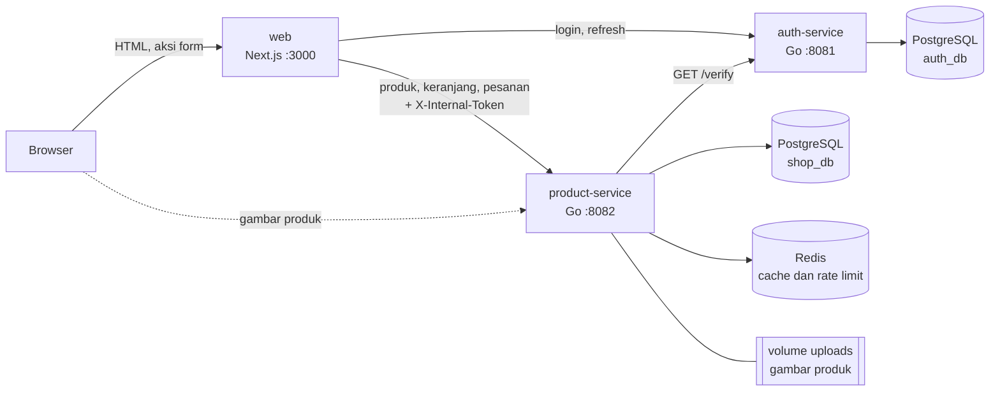
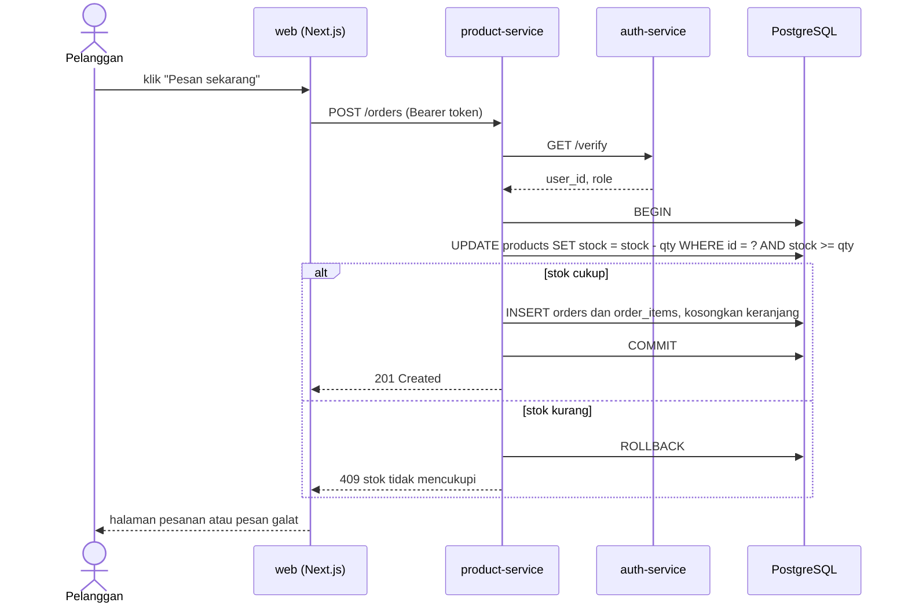

# TokoHerbal

Aplikasi katalog dan pemesanan produk herbal/kosmetik dengan arsitektur microservices.
Proyek belajar dan portofolio: Go, PostgreSQL, Redis, Docker, dan Next.js.

## Arsitektur



Browser berbicara dengan `web`; server Next.js yang memanggil auth-service dan product-service, jadi tidak ada urusan CORS dan token
tidak pernah tersentuh JavaScript di browser (lihat bagian Frontend). Gambar produk dimuat langsung dari product-service.
Tiap service memiliki databasenya sendiri; tidak ada foreign key lintas database.

Alur membuat pesanan (satu transaksi, tidak bisa menjual stok berlebih):



Salinan gambar diagram: [`docs/arsitektur.svg`](docs/arsitektur.svg) dan [`docs/alur-pesanan.svg`](docs/alur-pesanan.svg).

## Fitur

- **Pelanggan:** katalog dengan pencarian, filter kategori, urutan dan paginasi; keranjang; checkout; riwayat dan pembatalan pesanan (stok dikembalikan).
- **Admin:** tambah, ubah, hapus produk; unggah gambar; mengubah status pesanan (`pending` → `paid` → `shipped` → `completed`).
- **Keamanan:** bcrypt, JWT 15 menit + refresh token berotasi dengan deteksi pemakaian ulang, token di cookie httpOnly, query berparameter, validasi isi file unggahan, pesan galat yang tidak membocorkan detail internal.
- **Ketahanan:** cache dan rate limit Redis dengan circuit breaker, respons 503 yang cepat saat auth-service mati, healthcheck, graceful shutdown.

## Teknologi

| Lapisan | Teknologi |
|---|---|
| Backend | Go (`net/http`, pgx, go-redis, `log/slog`) |
| Database | PostgreSQL 16 (dua database), Redis 7 |
| Frontend | Next.js 16 (App Router, Server Actions), React 19, TypeScript |
| Infrastruktur | Docker dan Docker Compose (image multi-stage; Go memakai distroless nonroot, web memakai Node alpine), GitHub Actions |
| Pengujian | `go test -race` (67 fungsi test, fake store tanpa database), skrip pembuktian di `scripts/` |

## Tangkapan layar

<!--


-->

Persiapan wawancara: [`docs/WAWANCARA.md`](docs/WAWANCARA.md) · demo dan CV: [`docs/DEMO-dan-CV.md`](docs/DEMO-dan-CV.md)

## Status tahap

- [x] Tahap 0: fondasi (Docker Compose, skema database, data contoh)
- [x] Tahap 1: auth-service (register, login, refresh token, logout, verify)
- [x] Tahap 2: product-service (CRUD, pencarian, paginasi, upload gambar)
- [x] Tahap 3: keranjang, pesanan, transaksi stok
- [x] Tahap 4: Redis (cache, rate limit)
- [x] Tahap 5: komunikasi antar service, 503, slog
- [x] Tahap 6: test dan CI
- [x] Tahap 7: frontend Next.js (katalog, login, keranjang, pesanan, admin)
- [x] Tahap 8: Docker penuh (web ikut `docker compose up`)
- [ ] Tahap 9: ulasan produk di MongoDB (opsional)
- [ ] Tahap 10: polesan, demo, wawancara (sedang dikerjakan)

## Menjalankan (Windows, Command Prompt)

Prasyarat: Docker Desktop sudah menyala (tunggu sampai statusnya "Engine running").

```bat
copy .env.example .env
```

Edit `.env`: isi `DB_PASSWORD` (huruf dan angka saja), `JWT_SECRET` dan `INTERNAL_TOKEN`. Buat secret acak dengan:

```bat
node -e "console.log(require('crypto').randomBytes(48).toString('hex'))"
```

`INTERNAL_TOKEN` (minimal 16 karakter) adalah rahasia bersama antara `web` dan product-service; buat dengan perintah yang sama.

Unduh dependensi Go dan jalankan test (sekali saja, ini juga membuat `go.sum` yang dibutuhkan Dockerfile):

```bat
cd auth-service
go mod tidy
go vet ./...
go test ./...
cd ..
```

> `go test -race` di Windows butuh compiler C (cgo) yang biasanya belum terpasang. Pakai `go test ./...` di laptop; `-race` dijalankan di CI (Linux) pada tahap 6.

Lalu:

```bat
docker compose up -d --build
docker compose ps
curl http://localhost:8081/health
```

Setelah semua service `healthy`, buka http://localhost:3000.

Isi data contoh produk (12 produk, aman dijalankan berulang):

```bat
docker compose exec postgres psql -U postgres -d shop_db -f /seed/seed.sql
```

Mengulang database dari nol (data hilang): `docker compose down -v`

## Port di laptop

| Layanan | Alamat |
|---|---|
| auth-service | http://localhost:8081 |
| PostgreSQL | localhost:5433 (user `postgres`) |
| product-service | http://localhost:8082 |
| Redis | localhost:6379 |
| web (Next.js) | http://localhost:3000 |

## Menjadikan akun sebagai admin

Register selalu membuat role `customer`. Ubah lewat SQL:

```bat
docker compose exec postgres psql -U postgres -d auth_db -c "UPDATE users SET role='admin' WHERE email='andi@example.com';"
```

Token lama tetap berisi role lama sampai kedaluwarsa (15 menit). Login ulang untuk mendapat role baru.

## Endpoint auth-service

| Method | Path | Akses | Fungsi |
|---|---|---|---|
| GET | /health | publik | Cek service dan koneksi database |
| POST | /register | publik | Buat akun (role selalu customer) |
| POST | /login | publik | Kembalikan access token dan refresh token |
| POST | /refresh | publik | Tukar refresh token dengan pasangan token baru |
| POST | /logout | publik | Cabut refresh token |
| GET | /verify | Bearer token | Kembalikan user_id dan role |

Contoh request siap pakai ada di `auth-service/requests.http` (ekstensi REST Client di VS Code).

## Endpoint product-service

| Method | Path | Akses | Fungsi |
|---|---|---|---|
| GET | /health | publik | Cek service dan database |
| GET | /products | publik | Daftar produk. Query: `q`, `category`, `sort` (newest, price_asc, price_desc, name), `page`, `limit` |
| GET | /products/{id} | publik | Detail produk |
| GET | /categories | publik | Daftar kategori |
| GET | /uploads/{nama} | publik | Gambar produk |
| POST | /products | admin | Tambah produk |
| PUT | /products/{id} | admin | Ubah produk |
| DELETE | /products/{id} | admin | Hapus produk |
| POST | /products/{id}/image | admin | Unggah gambar (field `image`, JPEG/PNG/WebP, maks 2 MB) |

Pemeriksaan token dilakukan dengan memanggil `GET /verify` di auth-service (timeout 3 detik).
Bila auth-service mati, endpoint admin membalas 503, bukan menggantung.

Cache Redis dan rate limit aktif selama `REDIS_ADDR` diisi (lihat bagian Redis).

Contoh request siap pakai: `product-service/requests.http`.

## Endpoint keranjang dan pesanan (product-service)

| Method | Path | Akses | Fungsi |
|---|---|---|---|
| GET | /cart | login | Isi keranjang beserta subtotal dan total |
| PUT | /cart/items/{product_id} | login | Isi atau ganti jumlah (body `{"qty": 2}`) |
| DELETE | /cart/items/{product_id} | login | Hapus satu produk dari keranjang |
| POST | /orders | login | Buat pesanan. Body `{}` = pesan isi keranjang, atau `{"items":[{"product_id":1,"qty":2}]}` |
| GET | /orders | login | Riwayat pesanan sendiri |
| GET | /orders/{id} | login | Detail pesanan (milik orang lain dijawab 404) |
| PATCH | /orders/{id}/status | login | Ubah status. Pelanggan hanya boleh `cancelled` pada pesanannya sendiri |
| GET | /admin/orders | admin | Semua pesanan, filter `?status=` |

Alur status: `pending` -> `paid` -> `shipped` -> `completed`. Batal boleh saat `pending` atau `paid`
dan mengembalikan stok. Pembayaran disimulasikan (admin yang menandai `paid`).

### Keamanan stok

Membuat pesanan berjalan dalam SATU transaksi database: kurangi stok, buat pesanan, buat item, kosongkan keranjang.
Stok dikurangi dengan `UPDATE ... WHERE stock >= qty`, jadi dua pembeli yang berebut stok terakhir
tidak bisa sama-sama berhasil. Buktikan sendiri (setelah `docker compose up`):

```bat
node scripts/race-order.mjs EMAIL_ADMIN PASSWORD_ADMIN
```

Contoh request siap pakai: `product-service/orders.http`.

## Redis: cache dan rate limit (Tahap 4)

- **Cache-aside** untuk `GET /products`, `GET /products/{id}`, dan `GET /categories`. Key berawalan `products:`, TTL 60 detik.
  Log `cache HIT` / `cache MISS` muncul di `docker compose logs -f product-service`.
- **Invalidasi**: tambah, ubah, hapus produk, unggah gambar, membuat pesanan, dan membatalkan pesanan menghapus semua key `products:*`.
- **Rate limit**: maksimal `RATE_LIMIT_PER_MIN` (bawaan 60) permintaan per IP per menit, di luar `/health`. Lebih dari itu dijawab `429` dengan header `Retry-After`.
  Dari sisi product-service, semua pengunjung web terlihat berasal dari satu IP (container `web`). Karena itu panggilan
  server-ke-server yang membawa header `X-Internal-Token` yang benar (`INTERNAL_TOKEN`) tidak dibatasi; akses langsung tanpa token tetap dibatasi.
  Perbandingan token memakai `subtle.ConstantTimeCompare`, dan token kosong berarti fitur mati.
- **Redis mati tidak mematikan aplikasi**: request tetap dilayani dari database (cache dilewati) dan rate limit dilewati.
  `/health` menandai `"redis": "down"` tetapi tetap 200, karena Redis hanyalah optimasi.
- **Circuit breaker + batas waktu keras (300 ms) untuk setiap operasi Redis** (`internal/breaker`). Tanpa ini, Redis yang mati
  membuat tiap perintah menggantung belasan detik (nama host `redis` gagal di-resolve), satu request memanggil Redis 2-3 kali,
  dan totalnya melewati `WriteTimeout` server (klien menerima "Empty reply"; `/health` jadi lambat dan container `unhealthy`).
  Sekarang: tiga kegagalan berturut-turut membuka breaker, panggilan ke Redis ditolak instan selama 10 detik, lalu dicoba lagi satu per satu.
  Ukuran: request pertama saat Redis mati sekitar 1 detik, berikutnya milidetik, `/health` tetap 200.
- Redis dibatasi `maxmemory 128mb` dengan kebijakan `allkeys-lru` (key paling lama tak terpakai dibuang saat penuh).

Pembuktian otomatis:

```bat
node scripts/redis-check.mjs EMAIL_ADMIN PASSWORD_ADMIN
node scripts/rate-limit-test.mjs
```

Uji Redis mati secara otomatis:

```bat
docker compose stop redis
node scripts/redis-down-check.mjs
docker compose start redis
node scripts/redis-down-check.mjs --recover
```

## Ketahanan antar service (Tahap 5)

product-service tidak memegang `JWT_SECRET`; ia bertanya ke auth-service (`GET /verify`) pada setiap request yang butuh login.
Bila auth-service mati:

- Halaman dan endpoint publik (`GET /products`, dan seterusnya) tetap 200.
- Endpoint yang butuh login dijawab `503` dengan `Retry-After: 5`, bukan menggantung dan bukan crash.
- Klien auth memakai circuit breaker (`internal/breaker`, dipakai ulang dari Redis): tiga kegagalan beruntun membuka breaker selama
  5 detik, dan request berikutnya langsung 503. Token ditolak (401) tidak dihitung sebagai kegagalan.
- `request_id` diteruskan lewat header `X-Request-ID` sehingga satu permintaan bisa dilacak di log kedua service (log JSON, `slog`).

```bat
node scripts/auth-down-check.mjs EMAIL PASSWORD
docker compose stop auth-service
node scripts/auth-down-check.mjs --token TOKEN_YANG_DICETAK
docker compose start auth-service
```

## Test dan CI (Tahap 6)

`.github/workflows/ci.yml` berjalan pada setiap push ke `main` dan setiap pull request, untuk kedua service:
`gofmt`, `go mod tidy` tidak boleh mengubah apa pun, `go vet`, `go test -race`, lalu `docker build`.
Versi Go dibaca dari `go.mod` sehingga tidak ada angka versi ganda.

## Frontend (Tahap 7)

Next.js 16 (App Router, TypeScript), folder `web/`. Halaman: katalog (pencarian, kategori, urutan, paginasi), detail produk,
daftar dan masuk, keranjang, checkout, riwayat dan pembatalan pesanan, serta `/admin/*` (produk, unggah gambar, status pesanan).

Keputusan rancangan:

- **Token di cookie httpOnly**, diatur oleh server Next.js (Server Actions). JavaScript di browser tidak bisa membacanya,
  jadi pencurian lewat XSS tidak mungkin. Browser tidak pernah memanggil auth-service langsung.
- **Refresh otomatis di `proxy.ts`**: sebelum halaman dirender, access token yang habis atau tinggal kurang dari 20 detik diperbarui
  memakai refresh token. Refresh token berotasi dan auth-service mendeteksi pemakaian ulang (dianggap pencurian), jadi refresh
  dijaga **satu kali per token** (single-flight, hasilnya disimpan 15 detik untuk request yang terlambat). Bila auth-service mati,
  pengguna tidak dikeluarkan dan cookie tidak dihapus.
- Parameter `next` pada login hanya menerima path di situs sendiri (`//evil.com` ditolak).
- Hak akses sebenarnya ditegakkan API (admin saja → 403); penjagaan di halaman admin hanya kenyamanan.
- Server Action secara bawaan membatasi body 1 MB; `next.config.ts` menaikkannya ke 3 MB agar unggah gambar (maks 2 MB) tidak gagal.
- `PUBLIC_PRODUCT_URL` (alamat gambar untuk browser) dibaca saat berjalan, bukan ditanam saat build, sehingga satu image dipakai di lingkungan mana pun.

Menjalankan untuk pengembangan (backend lewat Docker):

```bat
cd web
copy .env.example .env.local
npm install
npm run dev
```

## Tampilan dan aturan admin (Tahap 11)

- **Tampilan**: tema "rak jamu". Kategori adalah botol di rak pada beranda; ilustrasi botol yang sama dipakai sebagai gambar produk bila belum ada foto. Font Bricolage Grotesque dan Figtree dibundel lokal (tanpa Google Fonts), tema terang saja.
- **Admin tidak berbelanja.** Akun admin mengelola toko, jadi tidak punya keranjang atau pesanan pribadi.
  - API: `GET/PUT/DELETE /cart...`, `POST /orders`, dan `GET /orders` membalas **403** untuk admin (`TestAdminCannotShop`).
  - UI: menu admin hanya *Kelola produk* dan *Pesanan masuk*; di halaman produk tombol beli diganti *Ubah produk*; `/keranjang`, `/pesanan`, `/pesanan/{id}` dialihkan ke `/admin/pesanan`.
  - Admin tetap boleh melihat semua pesanan dan mengubah statusnya.

## Keterbatasan yang diketahui

- Pembayaran disimulasikan (admin menandai `paid`); tidak ada payment gateway.
- Gambar produk dimuat langsung oleh browser dari product-service dan tetap dihitung ke rate limit per IP; browser menyimpannya
  24 jam sehingga dampaknya kecil.
- Ketahanan Redis dan auth diuji dengan simulasi dan skrip; belum ada uji beban.
